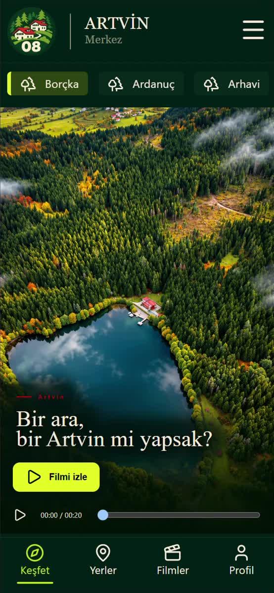
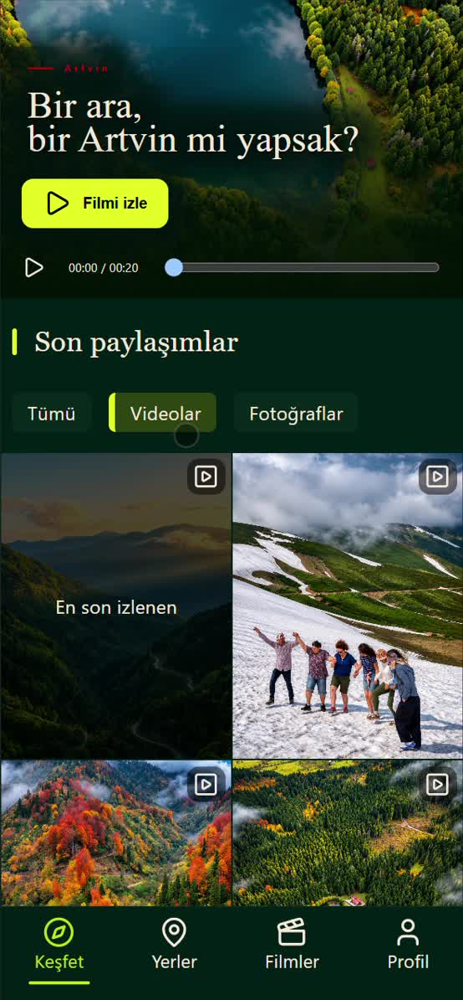
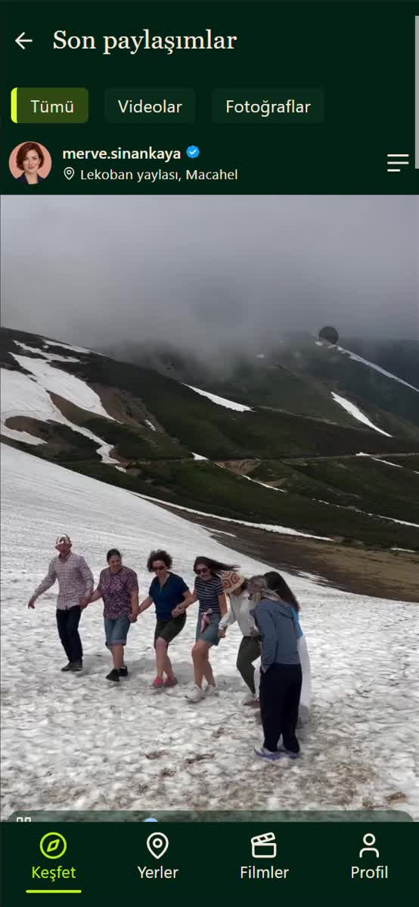
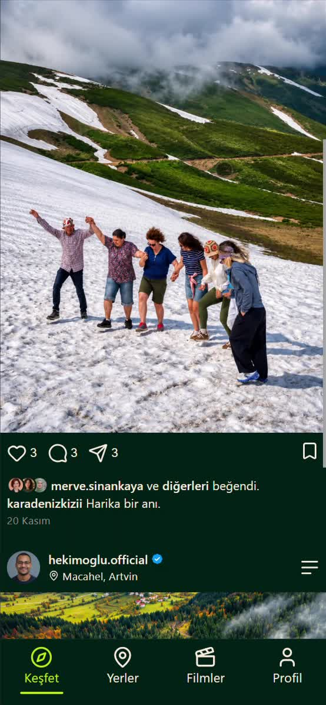

# Sıfır Sekiz

Sıfır Sekiz is a mobile-first media platform for discovering Artvin, Türkiye, through nature photography, short films, and drone footage from Macahel and across the province.

[Visit sifirsekiz.com](https://sifirsekiz.com)

## Explore Artvin

- **Keşfet** opens with a featured film and a preview of recent posts.
- **Son paylaşımlar** lets visitors filter the grid by photos or videos and open a post directly in the feed.
- **The post feed** brings together location details, captions, full-width photography, and custom video controls.

## Mobile preview

| Explore | Latest posts | Video post | Photo post |
| --- | --- | --- | --- |
|  |  |  |  |

## Technology stack

| Layer | Technologies |
| --- | --- |
| Frontend | React, TypeScript, Vite, CSS, Lucide React |
| Backend API | C#, ASP.NET Core Web API (.NET 9) |
| Data access and persistence | Entity Framework Core, PostgreSQL |
| API documentation | Swagger / OpenAPI |

## Development status

The mobile preview shows the Explore page, media filters, and post feed. Backend integration is in progress. The API will provide the data for the feed, including photo and video post records, captions, and Artvin district and village information.
